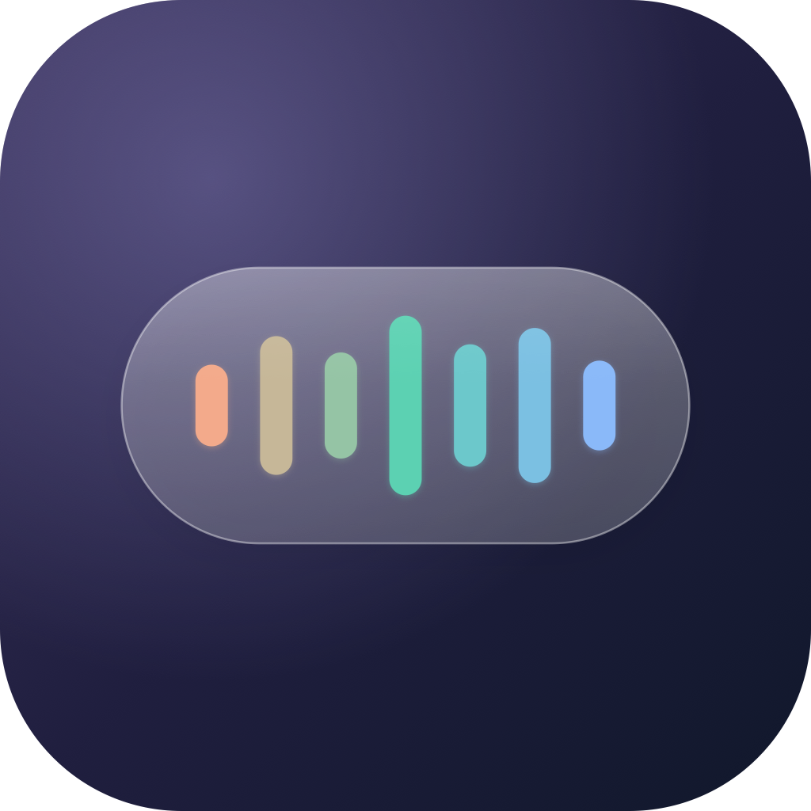
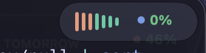
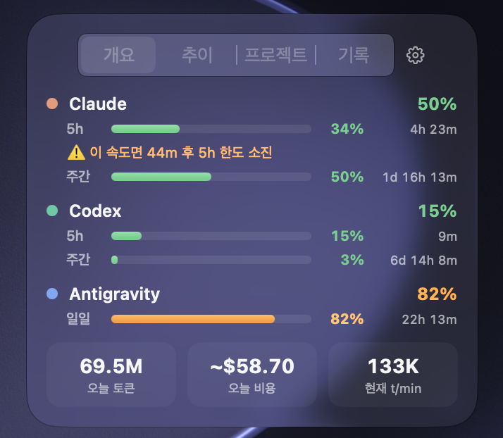
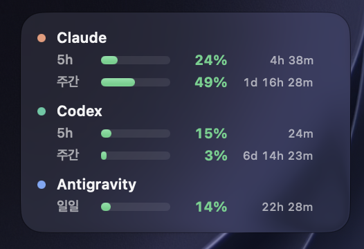
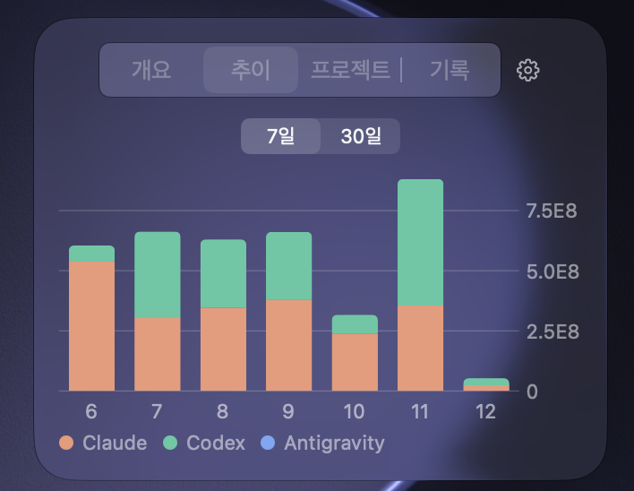
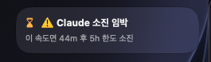
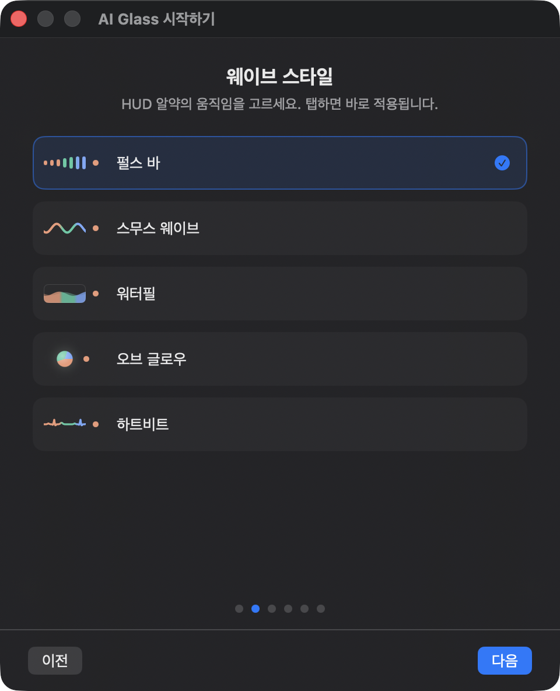

<p align="center">
  
</p>

<h1 align="center">AI Glass</h1>

<p align="center">
  Claude Code · Codex · Antigravity · Kimi Code 사용량을 <b>liquid glass</b>로 보여주는 macOS 메뉴바 앱
</p>

<p align="center">
  <a href="README.md">English</a> · <b>한국어</b>
</p>

<p align="center">
  <a href="https://github.com/taeng0204/ai-glass/releases"></a>
  <a href="https://github.com/taeng0204/ai-glass/actions/workflows/ci.yml"></a>
  
  
  <a href="LICENSE"></a>
</p>

<p align="center">
  
</p>

화면 우상단에 항상 떠 있는 **펄스 웨이브 알약**이 AI 코딩 에이전트들의 토큰 소모를 실시간으로 보여줍니다. 토큰이 빨리 탈수록 파도가 크게 출렁이고, 색 띠는 지금 어떤 에이전트가 일하는지 알려줍니다. 한도가 임박하면 알약이 카드로 모핑되며 경고하고, 새 세션이 시작되면 지난 세션을 요약해줍니다.

## 설치 (원클릭)

```bash
curl -fsSL https://raw.githubusercontent.com/taeng0204/ai-glass/main/install.sh | bash
```

최신 릴리스를 받아 `/Applications`에 설치하고 바로 실행합니다. 또는 [Releases](https://github.com/taeng0204/ai-glass/releases)에서 zip을 직접 받아 `/Applications`에 넣어도 됩니다 (이 경우 최초 실행은 **우클릭 → 열기** — 릴리스 빌드는 ad-hoc 서명이라 Gatekeeper 확인이 한 번 필요합니다).

> 요구사항: **macOS 26 (Tahoe) 이상** — 네이티브 liquid glass API를 사용합니다. Claude Code / Codex / Antigravity(`agy`) / Kimi Code 중 1개 이상 사용 이력이 있으면 됩니다.

## 기능

- **플로팅 HUD**: 우상단 glass 알약, 웨이브 스타일 5종, 6초 서비스 로테이션, 호버 시 에이전트별 5h·주간 게이지+리셋 카운트다운, 드래그 이동, ⌘⇧E 고정 확장 — 또는 **메뉴바 미니 알약** 모드로 메뉴바 안에서 웨이브 표시 (HUD를 꺼도 알림 카드는 그 위치에 떠오름)
- **대시보드**: 메뉴바 ✦ 클릭 또는 ⌘⇧U, 개요(윈도우별 게이지·소진 예측·오늘 토큰/비용/속도), 추이(7/30일 스택 차트 + **사용 잔디** — GitHub 스타일 15주 히트맵), 프로젝트(디렉토리별, 에이전트 색 구분), 기록(알림 히스토리, 호버 시 알약 리플레이)
- **이벤트**: 한도 70/90% 임박, 세션 리셋(직전 세션 요약), 토큰 급증, 소진 예측, 복귀 인사
- **브리핑**: 아침(어제 요약+스트릭 🔥), 점심(오늘 페이스 예측), 저녁(오늘 요약), 월요일 주간 리포트 📊
- **재미**: 마일스톤 돌파 🎉, 일일 신기록 🏆, 사운드 옵션
- **메뉴바**: 웨이브 알약·오늘 토큰·소모 속도·사용률·리셋 카운트다운을 원하는 만큼 골라 한 줄에 표시 (모두 끄면 ✦ 아이콘만)
- **온보딩**: 첫 실행 시 HUD/메뉴바 사용 방식(트랙)을 고르고, 웨이브 스타일·메뉴바 항목·에이전트를 라이브 프리뷰로 선택
- **업데이트 알림**: 새 버전이 나오면 알림 1회 + 대시보드 헤더에 ↓ 배지 (클릭 시 릴리스 페이지)

### 에이전트별 한도

| 에이전트 | 표시되는 것 |
|---|---|
| **Claude Code** | Anthropic 사용량 API의 정확한 5h / 주간 사용률 |
| **Codex** | 세션 로그의 rate limit 스냅샷. 창 길이로 종류를 판별하므로 **주간 전용 요금제**(예: Pro)는 가짜 5h 게이지 대신 주간 게이지로 표시 |
| **Antigravity** | `agy -p "/usage"`로 가져온 **Gemini 4 Argon** 그룹의 실제 쿼터(5h / 주간). `agy`가 없거나 30분 넘게 실패하면 요청 수 기반 일일 추정 게이지로 대체 |
| **Kimi Code** | Kimi 사용량 API의 5h / 주간 / 월간 한도 (아래 주의 참고) + 세션 로그의 토큰 사용량 |

## 메뉴바 렌더링 (GPU)

메뉴바 아이템 안에서 연속 애니메이션을 돌리면 비용이 큽니다. macOS가 프레임마다, 그리고 모니터마다 아이템을 CPU로 다시 그리기 때문입니다. 단순한 SwiftUI 알약은 에이전트가 일하는 동안 **CPU를 60% 안팎** 썼습니다.

AI Glass는 상태 아이템으로 자리만 잡고, 그 위에 겹친 투명한 클릭 통과 패널에 알약을 그려 Core Animation으로 움직입니다. 애니메이션은 합성기(GPU)가 재생하고 앱은 텍스트·색 갱신을 위해 1초에 한 번만 깨어나서, 5가지 웨이브 스타일 모두 **CPU 0.5~1% 수준**입니다.

- 오버레이는 **메인 모니터**의 메뉴바에만 그려집니다. 보조 모니터에서는 macOS가 아이템 자리를 빈칸으로 보여줍니다.
- macOS가 아이템을 숨기면(예: 앞에 있는 앱의 메뉴가 너무 길 때) 오버레이도 같이 숨겨집니다.

## 스크린샷

<table align="center">
  <tr>
    <th width="50%">대시보드 메인</th>
    <th width="50%">HUD 확장</th>
  </tr>
  <tr>
    <td align="center"></td>
    <td align="center"></td>
  </tr>
  <tr>
    <th width="50%">추이 차트</th>
    <th width="50%">한도 알림</th>
  </tr>
  <tr>
    <td align="center"></td>
    <td align="center"></td>
  </tr>
</table>

<p align="center">
  
</p>

## 데이터 소스 & 프라이버시

모든 처리는 **로컬**에서 이루어지며 텔레메트리는 없습니다. 앱이 직접 보내는 외부 네트워크 요청은 세 가지뿐입니다 — Claude 한도 조회용 Anthropic 사용량 API, Kimi 한도 조회용 Kimi 사용량 API, 새 버전 확인용 GitHub Releases API(하루 1회). Antigravity 쿼터를 위해 앱이 실행하는 `agy` CLI는 자체적으로 Google과 통신합니다.

- **Claude**: `~/.claude/projects/**/*.jsonl` (토큰·모델·프로젝트) + Keychain의 Claude Code OAuth 토큰 → 사용량 API (정확한 5h/주간 %). 토큰은 해당 Keychain 항목이 이미 신뢰하는 macOS `security` 도구로 읽기 때문에 **암호 다이얼로그가 뜨지 않습니다.**
- **Codex**: `~/.codex/sessions/**/*.jsonl` (rate limit 스냅샷 + 토큰 + 프로젝트)
- **Antigravity**: `~/.gemini/antigravity-cli/history.jsonl` (요청 수·프로젝트) + `conversations/*.db` (SQLite 대화 DB의 protobuf 메타데이터에서 입·출력 토큰을 **추정** — 비공개 포맷이라 방어적으로 파싱하며 결과는 추정치로 취급). 한도는 5분마다 `agy -p "/usage"`를 실행해 가져옵니다 (모델 호출 없음, 인증은 CLI가 처리).
- **Kimi Code**: `~/.kimi-code/sessions/**/wire.jsonl` (`usage.record` 이벤트, 프로젝트는 세션의 `state.json`에서). 한도는 Kimi CLI의 OAuth 토큰으로 `GET {base_url}/usages`를 호출해 가져옵니다. 이 토큰은 수명이 약 15분이고 CLI가 갱신하므로 **Kimi CLI를 실제로 쓰는 동안에만 한도가 갱신**되고, 그 외에는 마지막 값을 유지합니다.
- 일별 통계는 `~/Library/Application Support/AIGlass/stats.db` (SQLite)에 저장
  라이브 화면은 최근 8일만 메모리에 두지만, 첫 실행 때(그리고 파서가 바뀌는 업그레이드 후)에는 **최근 35일치 로그를 백그라운드에서 한 번 통계 DB에 채웁니다.** 그래서 30일 추이와 잔디가 하루씩 쌓이길 기다리지 않고 바로 채워집니다.

비용 표시는 **API 단가 환산 추정치**입니다 — 구독 플랜 실비가 아닙니다. 정액제인 Kimi Code는 입력/출력 100만 토큰당 $2 / $10, 캐시 읽기는 10%로 가정합니다.

## 소스에서 빌드

```bash
git clone https://github.com/taeng0204/ai-glass.git && cd ai-glass
swift test                 # 단위 테스트 (206개)
swift run AIGlass          # 개발 실행 (자동시작·알림은 .app 번들 전용)
bash Scripts/make-app.sh   # .app 번들 생성 → build/AIGlass.app
swift run AIGlass --check-claude   # Claude 한도 API 연결 진단
```

**선택 — 고정 서명 신원.** 기본적으로 `make-app.sh`는 ad-hoc 서명이라 재빌드할 때마다 macOS에는 "새 앱"으로 보입니다 (예: Gatekeeper가 다시 묻습니다). 재빌드해도 신원이 유지되게 하려면 아래를 한 번 실행하세요. 이후 `make-app.sh`가 로컬 인증서 `AIGlass Local`로 자동 서명합니다.

```bash
bash Scripts/setup-signing.sh
```

## 단축키

- **⌘⇧U** — 대시보드 열기/닫기
- **⌘⇧E** — 알약 확장 고정/해제

## 라이선스

[MIT](LICENSE) © 2026 taeng0204
