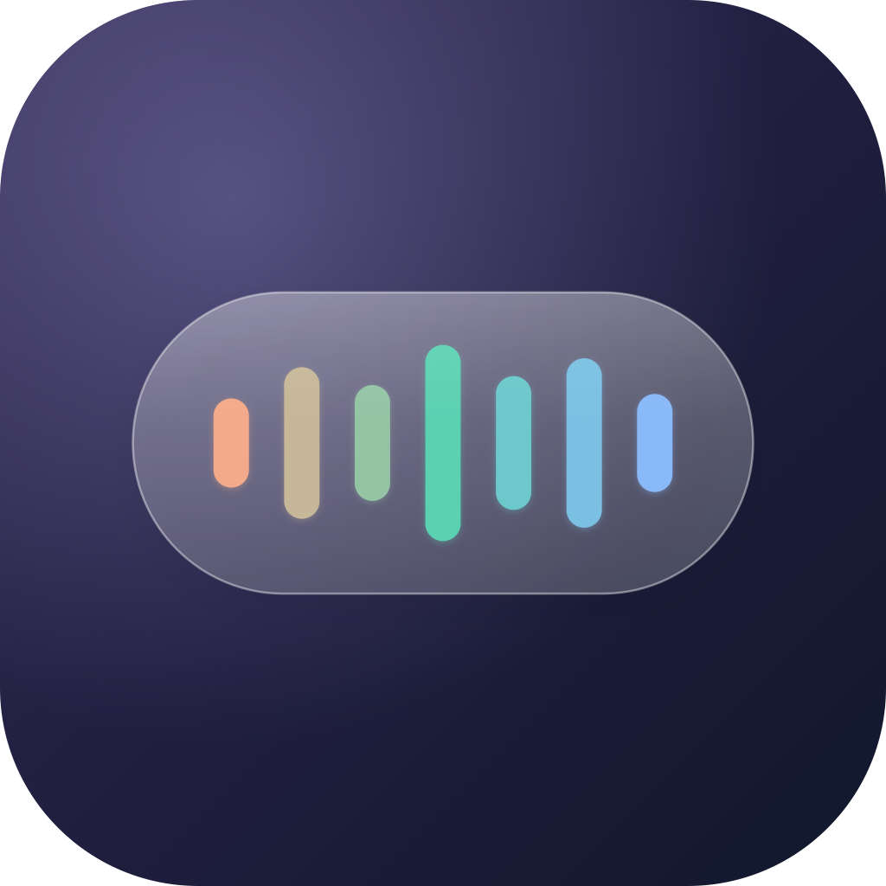
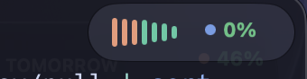
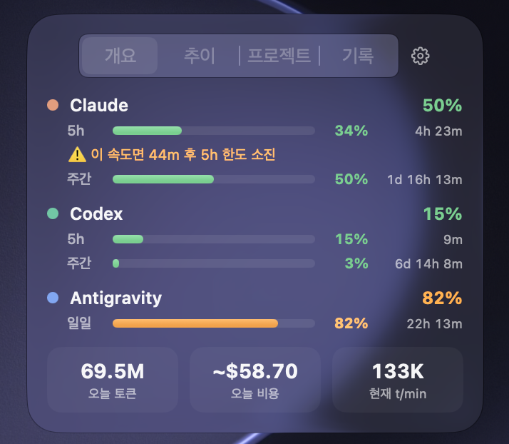
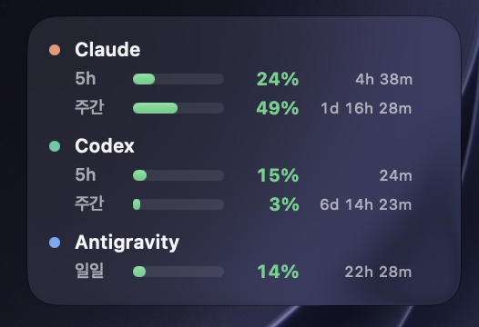
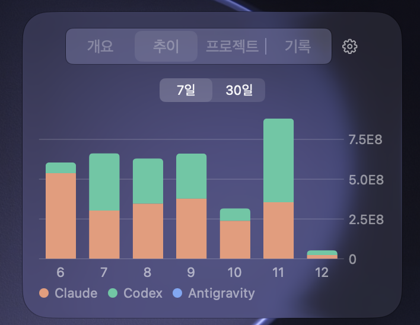
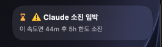
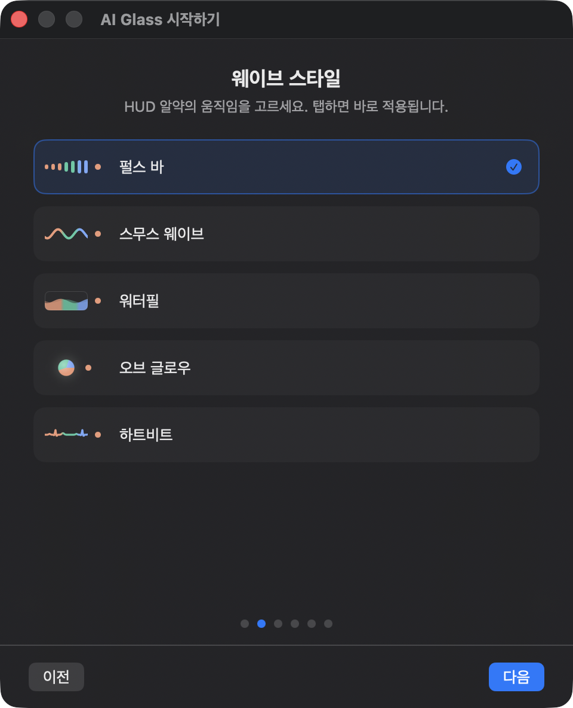

<p align="center">
  
</p>

<h1 align="center">AI Glass</h1>

<p align="center">
  A macOS menu bar app that shows your <b>Claude Code · Codex · Antigravity · Kimi Code</b> usage in <b>liquid glass</b>
</p>

<p align="center">
  <b>English</b> · <a href="README.ko.md">한국어</a>
</p>

<p align="center">
  <a href="https://github.com/taeng0204/ai-glass/releases"></a>
  <a href="https://github.com/taeng0204/ai-glass/actions/workflows/ci.yml"></a>
  
  
  <a href="LICENSE"></a>
</p>

<p align="center">
  
</p>

A **pulse-wave pill** floats in the corner of your screen and shows, in real time, how fast your AI coding agents are burning tokens. The faster they burn, the bigger the waves; the color bands tell you which agent is working right now. When a limit is about to run out the pill morphs into a warning card, and when a new session starts it summarizes the previous one.

## Install (one line)

```bash
curl -fsSL https://raw.githubusercontent.com/taeng0204/ai-glass/main/install.sh | bash
```

This downloads the latest release, installs it into `/Applications` and launches it. You can also grab the zip from [Releases](https://github.com/taeng0204/ai-glass/releases) and drop it into `/Applications` (the first launch then needs **right-click → Open**, because release builds are ad-hoc signed and Gatekeeper asks once).

> Requirements: **macOS 26 (Tahoe) or later** — the app uses the native liquid glass APIs. You need a usage history with at least one of Claude Code, Codex, Antigravity (`agy`) or Kimi Code.

## Features

- **Floating HUD** — a glass pill in the corner with 5 wave styles, 6-second agent rotation, hover for per-agent 5h / weekly gauges with reset countdowns, drag to move, ⌘⇧E to pin it expanded. Or use the **menu bar mini pill** mode to show the wave right in the menu bar (alert cards still pop up at the HUD position even when the HUD is off).
- **Dashboard** — click ✦ in the menu bar or press ⌘⇧U. Overview (per-window gauges, depletion forecast, today's tokens / cost / speed), Trends (7/30-day stacked chart and a GitHub-style 15-week **usage heatmap**), Projects (per directory, colored by agent), History (alert log; hover to replay the pill).
- **Events** — limit warnings at 70 / 90 %, session resets (with a summary of the last session), token spikes, depletion forecasts, welcome-back messages.
- **Briefings** — morning (yesterday's recap + streak 🔥), noon (today's pace forecast), evening (today's recap), Monday weekly report 📊.
- **Fun** — milestone celebrations 🎉, daily records 🏆, optional sounds.
- **Menu bar** — pick any combination of the wave pill, today's tokens, burn rate, usage % and reset countdown on a single line (turn them all off for just the ✦ icon).
- **Onboarding** — on first launch choose HUD or menu bar, then pick wave style, menu bar items and agents with live previews.
- **Update notice** — one notification when a new version is released, plus a ↓ badge in the dashboard header.

### Per-agent limits

| Agent | What is shown |
|---|---|
| **Claude Code** | Exact 5h / weekly usage % from the Anthropic usage API |
| **Codex** | Rate-limit snapshots from the session logs. Windows are classified by their length, so **weekly-only plans** (e.g. Pro) show a weekly gauge instead of a bogus 5h one |
| **Antigravity** | Real quota from `agy -p "/usage"` for the **Gemini 4 Argon** group (5h / weekly). If `agy` is missing or fails for 30 minutes, it falls back to an estimated daily-request gauge |
| **Kimi Code** | 5h / weekly / monthly limits from the Kimi usage API (see the caveat below) + token usage from the session logs |

## Menu bar rendering (GPU)

Continuous animation inside a menu bar item is expensive: macOS re-renders the item on the CPU for every frame, and once per display. A naive SwiftUI pill burned **~60 % CPU** while agents were running.

AI Glass instead reserves the space with the status item and draws the pill in a transparent, click-through panel on top of it, animated with Core Animation. The compositor (GPU) plays the animation and the app only wakes once a second to update text and colors — **about 0.5–1 % CPU**, with all five wave styles.

- The overlay is drawn on the **main display's** menu bar only. On secondary displays macOS shows an empty slot where the item is.
- When macOS hides the item (for example, the frontmost app's menus are too long) the overlay hides with it.

## Screenshots

<table align="center">
  <tr>
    <th width="50%">Dashboard overview</th>
    <th width="50%">Expanded HUD</th>
  </tr>
  <tr>
    <td align="center"></td>
    <td align="center"></td>
  </tr>
  <tr>
    <th width="50%">Trends</th>
    <th width="50%">Limit alert</th>
  </tr>
  <tr>
    <td align="center"></td>
    <td align="center"></td>
  </tr>
</table>

<p align="center">
  
</p>

## Data sources & privacy

Everything is processed **locally** and there is no telemetry. The app itself makes only three kinds of network requests: the Anthropic usage API (Claude limits), the Kimi usage API (Kimi limits) and the GitHub Releases API (update check, once a day). The `agy` CLI, which the app runs for Antigravity quota, talks to Google on its own.

- **Claude** — `~/.claude/projects/**/*.jsonl` (tokens, model, project) plus the Claude Code OAuth token from the Keychain for the usage API (exact 5h / weekly %). The token is read through the macOS `security` tool, which is already trusted by that Keychain item, so **no password dialog appears**.
- **Codex** — `~/.codex/sessions/**/*.jsonl` (rate-limit snapshots, tokens, project).
- **Antigravity** — `~/.gemini/antigravity-cli/history.jsonl` (request count, project) and `conversations/*.db` (**estimated** input / output tokens from the protobuf metadata of the SQLite conversation DB — a private format, parsed defensively and treated as an estimate). Limits come from running `agy -p "/usage"` every 5 minutes (no model call; the CLI handles its own auth).
- **Kimi Code** — `~/.kimi-code/sessions/**/wire.jsonl` (`usage.record` events; the project comes from the session's `state.json`). Limits come from `GET {base_url}/usages` with the Kimi CLI's OAuth token. That token only lives for about 15 minutes and is refreshed by the CLI, so **limits update only while you are actively using the Kimi CLI**; otherwise the last known values are kept.
- Daily statistics are stored in `~/Library/Application Support/AIGlass/stats.db` (SQLite).
  The live view keeps the last 8 days in memory, but on first launch (and after upgrades that change the parsers) the app **backfills the last 35 days of logs into this database once** in the background, so the 30-day trend and heatmap are filled right away instead of growing day by day.

Cost figures are **API-price estimates**, not what your subscription actually costs. For Kimi Code (a flat-rate subscription) it assumes $2 / $10 per million input / output tokens, with cache reads at 10 %.

## Build from source

```bash
git clone https://github.com/taeng0204/ai-glass.git && cd ai-glass
swift test                 # unit tests (206)
swift run AIGlass          # dev run (autostart and notifications need the .app bundle)
bash Scripts/make-app.sh   # build the .app bundle → build/AIGlass.app
swift run AIGlass --check-claude   # diagnose the Claude limits API connection
```

**Optional — a stable signing identity.** By default `make-app.sh` signs ad-hoc, so every rebuild is a "new app" to macOS (for example Gatekeeper asks again). To keep a stable identity across rebuilds, run this once; `make-app.sh` then signs with the local certificate `AIGlass Local` automatically:

```bash
bash Scripts/setup-signing.sh
```

## Keyboard shortcuts

- **⌘⇧U** — open / close the dashboard
- **⌘⇧E** — pin / unpin the expanded pill

## License

[MIT](LICENSE) © 2026 taeng0204
